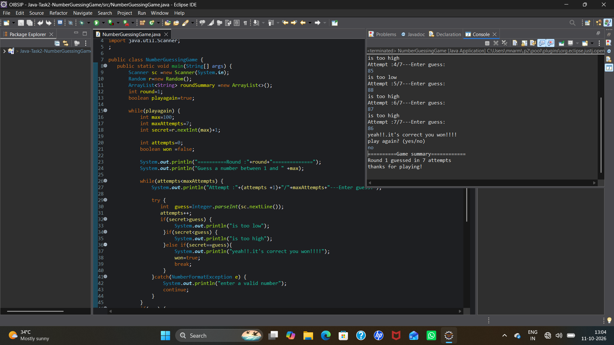

# Number Guessing Game

**Oasis Infobyte SIP | Java Development | Task 2**

A console-based number guessing game built in Java. The computer picks a random number and the player tries to guess it, getting "Too High" or "Too Low" hints after every attempt.

## Features

- Random number generated between 1 and 100 at the start of every round
- Hints after each guess: **Too High**, **Too Low** or **Correct**
- Attempt counter shown on every turn (for example, `Attempt: 7/7`)
- Maximum 7 attempts per round; on running out, the game ends with "You Lost!" and reveals the number
- Invalid input (letters or symbols) is handled with `try-catch` and does not use up an attempt
- "Play Again?" option after every round (yes/no)
- Score tracking across rounds, with a summary such as `Round 1 guessed in 7 attempts`

## Tech Stack

- Java
- Concepts used: `Random`, `Scanner`, `while` loops, `if-else`, `try-catch` (`NumberFormatException`), `ArrayList`

## How to Run

1. Clone the repository:
   ```
   git clone https://github.com/Narmatha-M-15/OIBSIP.git
   ```
2. Go to the project folder:
   ```
   cd OIBSIP/Java-Task2-NumberGuessingGame/src
   ```
3. Compile and run:
   ```
   javac NumberGuessingGame.java
   java NumberGuessingGame
   ```

Or open the project in Eclipse / IntelliJ and run `NumberGuessingGame.java`.

## Sample Output

```
==========Round :1==============
Guess a number between 1 and 100
Attempt :1/7---Enter guess:
76
is too low
Attempt :2/7---Enter guess:
80
is too low
Attempt :3/7---Enter guess:
90
is too high
Attempt :4/7---Enter guess:
85
is too low
Attempt :5/7---Enter guess:
88
is too high
Attempt :6/7---Enter guess:
87
is too high
Attempt :7/7---Enter guess:
86
yeah!!.it's correct you won!!!!
play again? (yes/no)
no
==========Game summary============
Round 1 guessed in 7 attempts
thanks for playing!
```

## Screenshots



## Author

**Narmatha M**
Java Development Intern, Oasis Infobyte
GitHub: [Narmatha-M-15](https://github.com/Narmatha-M-15)
